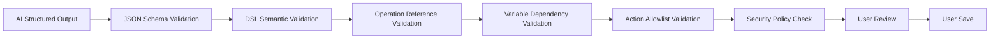

# AI 上下文与安全规范

## 1. 文档目的

本文规定 AI 可以接收哪些平台数据、上下文如何构建和脱敏、模型可以调用哪些工具，以及如何审计 AI 行为。

本规范从属于 [Test Agent 能力边界](C:/Users/blaine/Documents/code/automation-test-poc1/design/ai-assistance-boundaries.md)。Agent Task 见 [Test Agent 产品与架构设计](C:/Users/blaine/Documents/code/automation-test-poc1/design/test-agent-architecture.md)，Tool Effect 和授权模式见 [Test Agent 工具与执行治理](C:/Users/blaine/Documents/code/automation-test-poc1/design/test-agent-runtime-governance.md)。

## 2. 数据边界

### 2.1 可进入 AI Context 的数据

- OpenAPI Operation、Schema、Examples
- DSL Schema 和支持的 Action Catalog
- Scenario 和 Suite 的结构化定义
- Environment 和 Profile 名称及非敏感元数据
- 脱敏后的 Request 和 Response
- Assertion、Extract 和 Action 执行结果
- OpenAPI 版本差异
- 平台校验器返回的问题

### 2.2 不可进入 AI Context 的数据

- 任何 Secret 原始值
- 私钥和 Passphrase
- 未脱敏的认证 Header
- 真实 Cookie 和 Session
- 未经允许的生产业务数据
- 完整数据库记录
- 与当前任务无关的其他 Project 数据
- 没有分析价值的完整密文

### 2.3 数据分级

平台至少应定义：

| 等级 | 示例 | AI 使用 |
|---|---|---|
| Public | OpenAPI 公共字段、Operation 描述 | 可使用 |
| Internal | Scenario 结构、项目命名、脱敏报告 | 按任务使用 |
| Sensitive | 客户数据、内部 Header、生产响应 | 默认禁止，必须脱敏 |
| Secret | Token、密码、私钥、Passphrase | 永远禁止 |

## 3. AI Context Builder

所有 AI 功能必须通过统一的 `AI Context Builder` 获取上下文。

业务功能不能直接把数据库实体或完整 Execution JSON 发送给模型。

`AI Context Builder` 的职责：

1. 根据当前 Project 和用户任务选择最小上下文
2. 校验用户对资产的读取权限
3. 删除 Secret 字段
4. 对 Header、Query、Body 和 Evidence 做脱敏
5. 限制数据量和历史范围
6. 标记事实来源
7. 生成可审计的 Context Manifest

建议 Context Manifest 至少记录：

- Agent Task ID
- Project ID
- 使用的 Operation IDs
- 使用的 Scenario IDs 和版本
- 使用的 Execution IDs
- 脱敏策略版本
- Prompt Template 版本
- Model 标识

Manifest 不记录 Secret 或完整 Prompt 内容中的敏感数据。

## 4. 输出格式

Scenario 生成必须输出结构化 AST，并符合平台维护的 JSON Schema。

不允许把模型直接生成的 YAML 文本作为正式输入。

平台在校验通过后，可以将 AST 序列化为 YAML。

## 5. 输出校验链



任何校验失败都必须阻止进入保存流程，并把问题展示给用户。

## 6. 来源与假设

每个 AI Draft 应包含：

- 使用的 Operations
- 参考的 Scenario
- 关键设计说明
- AI 假设
- 校验警告
- 无法确认的信息

这些信息属于 Draft Metadata，不进入 Runner 执行语义。

## 7. AI 可调用的平台工具

后续实现 AI Tool Calling 时，应使用明确的白名单 Tool Registry。每个工具必须声明输入 Schema、输出 Schema、Tool Effect、权限要求、超时和审计策略。

允许的只读工具示例：

- `searchOperations`
- `getOperationSchema`
- `listScenarioSummaries`
- `getScenarioVersion`
- `getRedactedExecutionEvidence`
- `getSupportedActions`

允许的分析和 Draft 工具示例：

- `createScenarioDraft`
- `applyScenarioCommands`
- `validateScenarioDraft`
- `analyzeVariableDependencies`
- `compareOpenApiVersions`
- `calculateCoverage`

V1 允许的 Tool Effect 仅限：

- `READ`
- `DRAFT_WRITE`
- `VALIDATE`

`DRAFT_WRITE` 只能修改未保存 Draft，并且必须通过语义 Command Bus，不能直接写数据库、YAML 或任意 JSON。

V1 禁止提供给 Agent：

- 通用 SQL
- Shell
- 文件系统写入
- 任意 HTTP Client
- Secret Provider
- `saveScenario`
- `deleteScenario`
- `runScenario`
- `runSuite`
- `updateEnvironment`
- `updateProfile`

未来的 Sandbox 执行工具必须通过 Runner Facade 和 Approval Engine，不能向模型暴露通用 HTTP Client。

## 8. Secret 防护

Secret 防护必须在进入模型之前完成，不能依赖 Prompt 要求模型自行忽略。

至少需要处理：

- `Authorization`
- `Proxy-Authorization`
- `Cookie`
- `Set-Cookie`
- API Key Query Parameters
- Password 和 Token 字段
- Private Key Block
- Passphrase
- 平台配置中标记为 Secret 的变量

脱敏后应保留字段存在性和类型，例如：

```json
{
  "Authorization": "[REDACTED]",
  "clientId": "demo-client",
  "clientSecret": "[REDACTED]"
}
```

## 9. Project 隔离

AI Context 必须遵守当前用户和 Project 权限。

禁止：

- 跨 Project 检索相似 Scenario
- 使用其他 Workspace 的 Execution 作为示例
- 在 Context 中混入用户无权读取的资产
- 用模型缓存绕过平台权限

如未来支持跨 Project 模板，必须由用户显式发布为可共享模板。

## 10. 审计与可观测性

每次 AI 请求至少记录：

- Agent Task 和 Plan Revision
- 用户
- Project
- AI 功能类型
- Context Manifest
- 模型和 Prompt Template 版本
- 输出 Schema 版本
- Validation 结果
- 用户是否接受
- 最终保存的资产版本

每次 Tool Call 还应记录：

- Tool 名称和版本
- Tool Effect
- 输入摘要和输出摘要
- 目标资产和 `baseRevision`
- Approval ID
- 调用结果、耗时和错误类型

审计记录不得包含 Secret。

平台需要能够回答：

- 这段内容是否由 AI 生成
- AI 使用了哪些平台事实
- 用户修改了什么
- 用户是否保存和运行
- 失败是模型生成错误还是平台校验遗漏

## 11. 安全验收

任何 AI 功能上线前至少验证：

- Secret 不出现在模型请求中
- Context 不包含其他 Project 数据
- 模型不能调用非白名单工具
- 非法 Operation 和 Action 会被确定性校验拦截
- 模型输出不能直接进入 Runner
- 审计记录可以关联用户、Draft 和最终资产
- 模型不可用时不影响手工工作流
