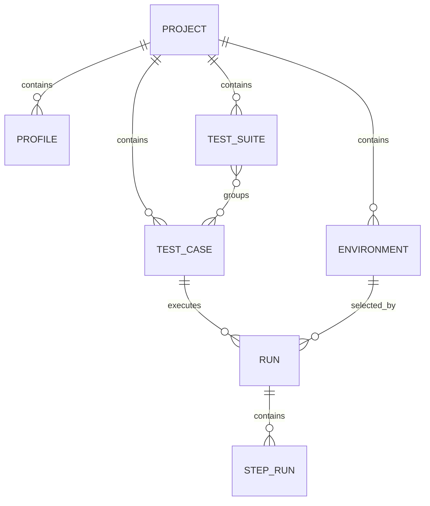

# 领域模型

## 1. 设计目标

领域模型需要解决两件事：

- 平台内部如何表达测试资产
- 执行引擎、UI、AI 能否共享同一套语义

因此模型应尽量稳定、结构化、可扩展，而不是围绕某个页面临时拼装。

## 2. 核心实体

### 2.1 Project

表示一个测试项目或业务域容器。

建议字段：

- `id`
- `name`
- `code`
- `description`
- `status`
- `createdAt`
- `updatedAt`

作用：

- 管理 case、suite、environment、profile 的归属范围

### 2.2 Environment

表示执行环境，例如 `dev` / `sit` / `uat`。

建议字段：

- `id`
- `projectId`
- `name`
- `baseUrls`
- `variables`
- `status`

作用：

- 提供环境变量与目标地址
- 区分不同环境运行结果

### 2.3 Profile

表示协议与安全配置。

建议字段：

- `id`
- `projectId`
- `name`
- `type`
- `senderPublicKeyRef`
- `senderPrivateKeyRef`
- `senderPrivateKeyPassphraseRef`
- `recipientPublicKeyRef`
- `recipientPrivateKeyRef`
- `recipientPrivateKeyPassphraseRef`
- `algorithm`
- `enabled`

作用：

- 为 step 提供安全协议上下文
- 隔离密钥细节与 case 内容

### 2.4 SecretRef

表示对敏感信息的引用，而不是明文保存。

建议字段：

- `id`
- `provider`
- `path`
- `maskedDisplay`

作用：

- 避免把私钥和 passphrase 散落在 case 或数据库中

### 2.5 TestCase

平台核心资产。

建议字段：

- `id`
- `projectId`
- `name`
- `code`
- `description`
- `tags`
- `dslVersion`
- `content`
- `status`
- `createdAt`
- `updatedAt`

说明：

- `content` 可以存完整 YAML/JSON DSL
- 后续也可拆成结构化存储 + 原始文本双轨

### 2.6 TestSuite

一组逻辑场景集合。

建议字段：

- `id`
- `projectId`
- `name`
- `description`
- `caseIds`

作用：

- 用于批量运行 smoke / regression / secure-protocol 场景

### 2.7 Run

表示一次执行记录。

建议字段：

- `id`
- `projectId`
- `caseId`
- `suiteId`
- `environmentId`
- `triggerType`
- `triggeredBy`
- `status`
- `startedAt`
- `finishedAt`
- `durationMs`
- `summary`

### 2.8 StepRun

表示 run 中每个 step 的执行证据。

建议字段：

- `id`
- `runId`
- `stepIndex`
- `stepName`
- `profileName`
- `status`
- `requestPlaintext`
- `requestWireBody`
- `responseStatus`
- `responseRawBody`
- `decryptedPayloads`
- `validations`
- `extractedValues`
- `errorMessage`

这是平台报告层最关键的实体。

## 3. 关系图

## 4. Case DSL 与领域模型关系

平台内部应当承认 `TestCase.content` 是当前阶段最重要的主数据。

平台 UI、执行器、校验器围绕以下概念工作：

- `variables`
- `profiles`
- `steps`
- `request`
- `request.transform`
- `expect.decrypt`
- `expect.validations`
- `extract`

也就是说，平台领域模型不是替代 DSL，而是为 DSL 提供管理、执行和可视化上下文。

## 5. 报告模型建议

平台报告中最有价值的并不是 run 总结，而是 `StepRun`。

建议平台报告优先围绕以下视图构建：

- `Request`
- `Response`
- `Decrypted Payloads`
- `Validations`
- `Extracted Values`
- `Error`

这对安全协议测试尤其关键。

## 6. 密钥与安全信息边界

不建议把以下内容直接写入 `TestCase.content`：

- 私钥明文
- passphrase 明文
- 动态 secret 值

建议让 case 只引用 profile 名称，再由 profile 引用 secret。

这样平台未来更容易支持：

- 多环境切换
- 密钥轮换
- 审计
- 权限隔离

## 7. 设计结论

领域模型的关键判断是：

- `TestCase` 是平台的资产中心
- `Run` 是平台的执行中心
- `StepRun` 是平台的证据中心
- `Profile` 和 `Environment` 是平台的配置中心

只要这四层关系稳定，平台后面无论做 UI、AI 生成还是调度扩展，都不会失去方向。
