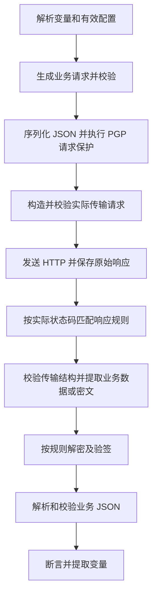

# PGP 接口测试 POC 方案

状态：提案，待评审。日期：2026-10-20。

2026-10-24：核心功能已实施，最终支持的配置、嵌套路径、Actions 顺序、扩展导入和历史快照见 [实施说明](operation-processing-implementation.md)。下文保留原提案过程，当前行为以实施说明为准。

本方案从业务需求重新设计，不受现有 pipeline、Actions 或数据结构约束，也不代表已经实现的行为。

## 1. 要解决的问题

部分 API 要求把原始业务请求做 PGP 加密，再通过 HTTP 发送；响应需要经过 PGP 解密，才能读取业务字段、断言和提取变量。

测试人员应围绕业务 JSON 编写用例。平台负责协议要求的加解密、报文封装和证据记录。同一个 API 的处理规则配置一次，被多个用例复用。

第一版验证三个结果：

1. 不修改服务方 OpenAPI，也能测试加密接口。
2. 编写用例时直接填写业务字段，对解密结果做断言。
3. 失败时能区分 HTTP、密文提取、解密、签名校验和业务断言问题。

## 2. 核心决定

采用“接口处理配置 + 固定 PGP 适配器”。平台内置 PGP 能力，用户通过表单配置需要的行为。

明确分开“加解密行为”和“接口报文映射”：前者可以跨 API 复用，后者由每个 operation 独立配置。PGP 能力只接收明文并产出密文，或接收密文并产出明文；它不知道字段叫 payload、encryptdata 还是其他名称。字段写入和提取由使用 operation 映射的报文组装/读取层负责。

第一版不引入通用 pipeline 编排器、脚本或流程编辑器。请求加密与响应解密各自独立启用；签名与验签必须显式配置，不能因为启用了 PGP 就默认存在签名。

配置保存在平台，绑定到导入的 API 资产和具体 operation。原始 OpenAPI 保留原样。第一版不要求解析平台专属 OpenAPI 扩展；可选扩展导入留到出现文档交付需求时再做。

## 3. 三类数据的归属

| 数据 | 所属位置 | 说明 |
| --- | --- | --- |
| HTTP method、path、参数、传输请求和响应 Schema | 原始 OpenAPI | 描述实际经过 HTTP 传输的报文 |
| 明文业务 Schema、PGP 选项、密文位置、响应处理规则 | 平台接口配置 | 补充 API 调用所需的业务和协议知识 |
| 环境地址、调用方私钥、对方公钥、口令引用 | 运行时 Profile | 随环境、调用身份选择，不进入接口契约或用例正文 |

例如，OpenAPI 的 requestBody 描述 `{ "payload": "密文" }`，平台的业务请求 Schema 描述订单字段。两者独立展示、独立校验，不能用明文 Schema 替换真实传输 Schema。

业务 Schema 可以引用原始 OpenAPI 中已有的 components/schemas，也可以在平台补充。平台引用必须携带所属 API 文档修订；不能从裸 `$ref` 猜测所属文档。

没有业务 Schema 时允许用 JSON 示例编写和执行用例，但不进行对应 Schema 校验，并标明“未配置业务结构”。示例推导出的 Schema 必须经用户确认才能作为校验依据。

## 4. 用户流程和页面

### 4.1 接入 API

1. 导入普通 OpenAPI。
2. 选择接口，启用 PGP 请求与响应处理；可以选择已有的加解密预设。
3. 为该接口指定请求密文写入位置、响应密文读取位置，再确认签名要求和加密格式。
4. 在具体接口补充明文业务请求和响应 Schema。
5. 使用一组业务 JSON 和一个运行时 Profile 做试调用，查看端到端结果。

加解密预设只复用请求保护、响应保护、PGP 表示等处理行为，不包含请求或响应字段位置。每个 operation 必须有明确的报文映射；普通接口选择“关闭处理”。请求和响应的位置互相独立，也不要求相同字段名。

不设置隐式的全 API 密文字段默认值。批量应用同一映射时，先列出目标接口并预览结果，再显式写入各接口配置。OpenAPI Schema 可以帮助列出可选字符串字段，但平台不能仅凭 payload/encryptdata 等名称推断哪一个字段保存密文。未完成映射的加密接口在执行前提示配置缺失。

页面显示所用预设和本接口的有效映射。第一版不增加项目、标签、目录等多层继承；加解密预设修改产生新修订，接口固定引用修订，升级时显式确认。

### 4.2 查看接口

接口详情默认展示明文业务结构；提供“业务数据 / 传输报文”切换。侧边或次级区域展示处理摘要，例如：

> 请求：PGP 签名并加密，写入 payload。响应：200 解密并验签，400/500 为普通 JSON。

未配置业务结构时以传输结构为主，并提供补充入口。密钥、原始配置文本和内部标识不占据主要编辑区域。

### 4.3 编写用例

- 选择接口后，默认编写业务请求 JSON，支持变量引用。
- HTTP 状态码、响应头和业务响应都可以作为断言来源。
- 从解密后的业务响应提取变量，传给下一步。
- 运行时选择环境和 Profile，用例不重复添加加解密动作。

断言和提取明确区分 `business.response.body` 与 `wire.response.body`，不让同一个 source 在不同接口上改变含义。UI 默认选中“业务响应”，用户通常只需填写业务字段路径。

## 5. 最小配置模型

### 5.1 PGP 处理配置

以下字段在存储上分成两组：可复用的加解密行为，以及 operation 独立的请求/响应映射。业务 Schema 和按状态码的响应规则也属于 operation。

| 配置项 | 第一版支持 |
| --- | --- |
| 请求保护 | 关闭、仅加密、签名并加密 |
| 请求业务格式 | UTF-8 JSON |
| 请求密文输出 | 整个 HTTP body，或 JSON 顶层字符串字段 |
| PGP 表示 | ASCII Armor |
| 请求封装 | 整个 body；或指定密文字段，可附带静态 JSON 兄弟字段 |
| 响应保护 | 普通 JSON、解密、解密并要求有效签名 |
| 响应密文输入 | 整个 HTTP body，或 JSON 顶层字符串字段 |
| 解密后格式 | UTF-8 JSON |
| 响应选择 | 按 HTTP 状态码配置处理方式和业务 Schema |

整个 body 的 ASCII Armor 是文本传输格式，JSON 字段封装是 JSON 格式。Content-Type 和传输 Schema 必须与之匹配；冲突在执行前提示，不能静默改写。

JSON 封装的 field 是每个接口可配置的字段名，不是固定值，也不是只允许 payload/encryptdata 的枚举。请求先生成密文，再按该接口 field 构造 JSON；响应先按该接口及状态码的 field 提取密文，再执行解密。字段缺失、类型不对或映射与传输 Schema 冲突时给出明确诊断。

第一版暂不支持部分业务字段加密、任意嵌套改写、自定义字节序列化、额外 Base64 层和任意处理顺序。需要其他格式时增加明确支持的模式。

响应规则匹配顺序：精确状态码 → 状态码范围（如 2XX）→ 显式 default。配置不允许同级重叠。没有匹配规则时记录 HTTP 响应并报告配置缺失，不猜测是否需要解密。

### 5.2 配置示例

以下仅说明新方案的数据含义，不是现有配置格式；用户通常通过表单维护。

```yaml
request:
  protection: pgp-sign-encrypt
  businessSchema:
    source: openapi
    ref: '#/components/schemas/CreateOrderPayload'
  wire:
    type: json-envelope
    field: payload

responses:
  '200':
    protection: pgp-decrypt-verify
    wire:
      type: json-envelope
      field: payload
    businessSchema:
      source: openapi
      ref: '#/components/schemas/Order'
  '400':
    protection: none
  '500':
    protection: none
```

所属 API 资产、文档修订和配置修订由平台记录，不在每个引用中重复填写。普通 JSON 响应的业务 body 等于原始 JSON body，仍可绑定相应业务 Schema。

同一 PGP 能力可以用于下面三个不同的接口映射，配置时分别选择位置：

| 接口 | 请求密文写入位置 | 200 响应密文读取位置 |
| --- | --- | --- |
| 创建订单 | JSON 字段 payload | JSON 字段 payload |
| 查询订单 | JSON 字段 encryptdata | JSON 字段 resultData |
| 提交文件信息 | 整个 HTTP body | JSON 字段 encryptedResponse |

以相同业务 JSON 为例，创建订单构造 `{ "payload": "<PGP密文>" }`，查询订单构造 `{ "encryptdata": "<PGP密文>" }`。这只是报文映射不同，无需实现两种 PGP 能力，也无需为字段名分别定义 pipeline。

复制创建订单的配置用于查询订单时，需要修改本接口 request.wire.field 和 response 的 wire.field。正式执行和预览都使用相同的映射解析结果。

### 5.3 Profile 与密钥角色

| 操作 | 使用的密钥 |
| --- | --- |
| 加密请求 | 服务方的加密公钥 |
| 签名请求 | 调用方的签名私钥 |
| 解密响应 | 调用方的解密私钥 |
| 验证响应签名 | 受信任服务方的验签公钥 |

界面可以按调用方/服务方组织材料，但配置模型要容许签名键与加密键分别引用。支持的算法、密钥版本和兼容格式由 PGP 库能力及服务协议明确限定，POC 不自行实现密码算法。

运行时 Profile 先使用场景级选择，必要时允许步骤整体覆盖。执行前校验所需材料是否齐全、可用且角色匹配；记录实际使用的公钥指纹和凭据版本引用，不记录私钥或口令。验签必须基于该 Profile 的受信任公钥，不能接受报文自带的任意公钥。

## 6. 执行顺序



- 普通 JSON 规则跳过 PGP 步骤，直接解析业务响应。
- 如果规则要求验签，缺少签名、签名无效或签名方不受信任都算处理失败。不可把相应明文发布为可信业务输出。
- 缺字段、密文格式错误、解密失败和验签失败必须分别报告；不能失败后自动改用明文解析。
- 是否解密由响应规则决定，不能用“body 看起来像密文”判断，也不能用断言预期的状态码选择规则。
- HTTP 状态断言独立记录。即使实际状态码不符合预期，也尽量按匹配规则完成响应处理，以保留调试证据；业务数据不可用时，相应断言标记为阻塞而非通过。
- Schema 校验失败保留已收到的报文；仍可安全执行的独立断言继续执行。缺少密文字段等导致处理前提不满足的情况停止该处理链。

执行引擎提供固定的请求编码和响应解码入口。UI 摘要、配置检查、试调用、正式运行及 AI 使用相同的解析后配置。第一版不再要求 AI 或用例作者另外拼装一份等价的加解密 Actions。

## 7. 负向测试

正常用例默认启用契约校验。测试非法业务数据时，步骤可明确选择“允许不符合请求 Schema”，绕过请求相关 Schema 阻断，仍执行配置的加密和封装；报告记录绕过情况。协议配置本身和运行时材料检查保持有效。

另提供高级选项“直接发送传输报文”：跳过业务请求构造、PGP 加密和请求 Schema 校验，直接发送用户提供的 body，避免二次加密。该模式适用于测试无效密文、缺少 payload 等输入。用户选择业务模式或传输模式后，页面和报告都显示明确标记。

响应仍使用接口规则。例如发送无效密文后收到 400 普通 JSON，就按 400 的规则处理。第一版不提供任意篡改有效 PGP 签名、定制损坏数据包等专用测试能力。

## 8. 执行证据

每个步骤保留以下结构化信息：

- 生效配置及来源、API 文档和配置修订、适配器版本。
- 业务请求、实际发送的 HTTP 请求、原始 HTTP 响应、业务响应。
- 加密、解密、验签、Schema 校验和断言的状态与耗时。
- 使用的公钥指纹、Profile 和凭据版本引用，以及分阶段错误原因。

默认展示业务请求和业务响应。传输报文与处理细节按需展开；出错时定位到失败阶段。业务明文与凭据分开处理，按已有查看权限和字段脱敏规则展示；私钥和口令禁止进入报告、普通日志及 AI 上下文。未通过要求的验签结果不能流入后续变量提取。

保存运行时有效配置快照，后续修改不会改变历史报告。历史记录用于解释当时的执行；使用旧凭据重新执行以其仍可用为前提。PGP 加密通常包含随机性，不以密文逐字节相同作为重跑成功标准。

## 9. 最小后端结构

逻辑上分为四个部分，POC 可以在同一进程部署：

1. 接口契约服务：合并原始 OpenAPI、业务 Schema 和接口处理配置，输出统一的接口视图。
2. 配置解析器：解析加解密预设、本接口的报文映射、响应规则及 Profile 需求，产出不可变的有效配置。
3. PGP 适配器及报文映射层：适配器只处理明文/密文；映射层按接口配置写入请求字段或提取响应字段，共同输出结果及阶段证据。
4. 测试执行器：处理变量、HTTP、断言、提取和报告，调用适配器。

最小持久化内容包括 API 文档修订、可选的加解密预设及其修订、operation 的业务 Schema/处理行为引用/报文映射，以及 Run 的有效配置快照。处理配置保存时递增修订，Runner 接收执行快照，不在每个处理阶段重新读取可变配置。

重新导入 OpenAPI 时，使用 API 资产内唯一 operationId 匹配；没有唯一 operationId 时以 method + path 匹配。方法、路径、Schema 或响应声明变化时，相关绑定标记待确认；不能把原配置静默应用到新语义的接口。无歧义且未发生相关变化的绑定可以继续使用。

## 10. AI 的使用边界

AI 获取明文业务 Schema、处理摘要、可用 Profile 的非敏感说明以及明确的断言来源，用于生成业务数据、断言和场景。

PGP 的调用顺序和封装行为由适配器确定。配置缺失时返回“需要补充接口处理规则”，不能凭模型推测协议并直接运行。AI 不需要访问私钥和口令。

## 11. 实施顺序与验收

### 第一阶段：完成可执行闭环

支持单接口处理配置、业务 JSON 输入、PGP 请求保护、响应解密、Profile 选择、业务断言及四类报文证据。先支持 JSON 顶层字段封装（字段名按接口配置，如 payload 或 encryptdata）和精确状态码响应规则。

验收：仅导入普通 OpenAPI 并在平台补充配置，即可完成“创建订单 → 从业务响应提取 orderId → 查询订单”，用例中无需重复定义加解密动作。创建与查询分别使用 payload、encryptdata 字段，响应字段也分别配置，验证映射确实按接口生效。

### 第二阶段：验证实际接入差异

增加共享加解密预设、接口映射批量配置预览、整 body Armor、静态封装字段、状态码范围/default 规则、明文错误响应以及负向测试模式。

验收至少覆盖：

| 场景 | 预期结果 |
| --- | --- |
| 请求加密、响应解密成功 | 可对业务字段断言和提取 |
| 签名必需，但签名缺失/无效/非受信任 | 报验签失败，不输出可信业务数据 |
| 无法解密的响应 | 报解密失败，保留原始响应 |
| 200 缺少指定密文字段 | 报密文提取失败，不回退明文 |
| 400 明文 JSON | 使用 400 规则正常解析并断言错误信息 |
| 实际状态不符预期 | 独立记录状态断言失败，仍处理可解析响应 |
| 两个接口分别映射 payload 和 encryptdata | 各自使用正确字段，复用同一 PGP 能力 |
| 请求使用 encryptdata、响应使用 resultData | 两个方向各自映射，不假设字段一致 |
| 启用加密但未配置密文位置 | 执行前提示缺失，不默认使用 payload |
| 接口关闭 PGP | 使用普通 JSON，不发生加解密 |
| 原始传输模式发送损坏密文 | body 原样发送，没有重复加密 |
| 业务请求故意不符合 Schema | 显式允许后仍按协议加密发送 |
| 执行后修改接口配置 | 历史报告仍展示原配置快照 |
| 重新导入导致 Schema 或接口语义变化 | 相关绑定提示待确认 |

### 第三阶段：改善复用和生成

完善批量应用配置、业务 Schema 编辑、试调用与错误定位，以及 AI 业务用例生成。只有出现多种真实转换需求时，再评估增加其他固定适配器或受控组合能力。

## 12. 参考

- [OpenAPI 3.0.3 Specification Extensions](https://spec.openapis.org/oas/v3.0.3.html#specification-extensions)：允许 x- 扩展，但其他工具不一定理解；扩展可用于未来的配置交换。
- [RFC 9580: OpenPGP](https://www.rfc-editor.org/rfc/rfc9580.html)：PGP 格式与行为的技术参考；具体实现兼容范围以所选库和对接协议为准。
- [平台 UI 指南](platform-ui-guidelines.md)：业务任务优先、结构化配置、渐进展示和执行证据。
