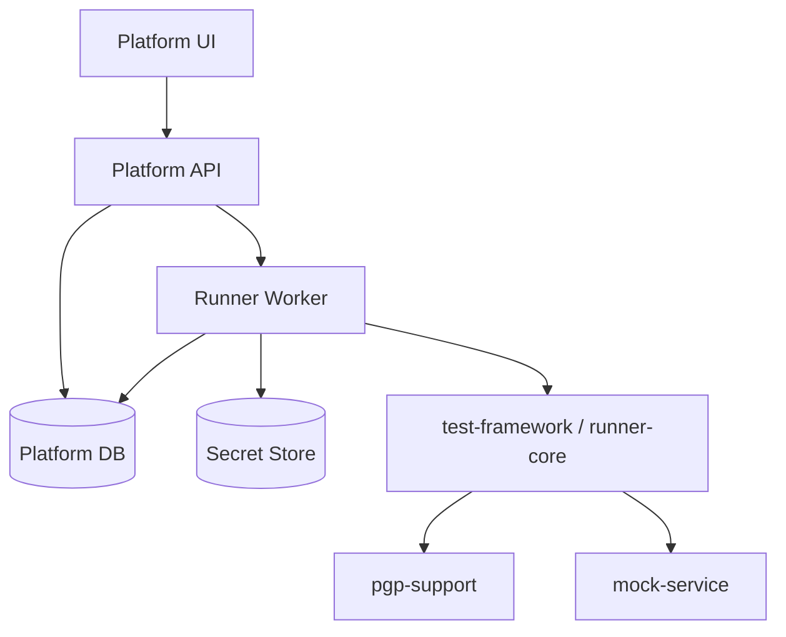

# 系统架构

## 1. 设计目标

POC 阶段的架构需要满足：

- 可以快速实现
- 可以从当前仓库自然演进
- 不把执行逻辑和平台管理逻辑完全耦死

因此建议采用“逻辑拆分明确，部署方式可以先合并”的架构。

## 2. 推荐架构分层

### 2.1 Platform API

职责：

- 管理项目、环境、profile、case、suite
- 触发 run
- 提供 run 查询与报告查询
- 提供 case schema 校验

### 2.2 Runner Worker

职责：

- 读取待执行 case
- 选择 environment/profile
- 调用执行引擎
- 生成 step evidence
- 回写 run / stepRun 结果

### 2.3 Storage

职责：

- 存储项目、case、run、stepRun、environment、profile 元数据

POC 阶段可选：

- PostgreSQL
- 或轻量关系型数据库

### 2.4 Secret Storage

职责：

- 保存密钥引用和 passphrase

POC 阶段可以先做“文件 + 环境变量”的简单模式，但架构设计上应预留 secret provider 的抽象。

### 2.5 UI

职责：

- 展示项目、case、run
- 触发执行
- 查看 step 级报告

### 2.6 Sandbox Service

职责：

- 作为 secure protocol 的联调和演示后端

当前仓库中的 `mock-service` 就是这个角色。

## 3. 当前仓库与未来架构映射

当前模块建议映射如下：

- `test-framework`
  平台中的 `runner-core`

- `pgp-support`
  平台中的共享协议能力库

- `mock-service`
  平台中的 sandbox service

未来新增建议：

- `platform-api`
- `platform-ui`
- `runner-worker`

POC 阶段可以先把 `platform-api` 和 `runner-worker` 放在同一个服务里做逻辑分层，不必一开始就分布式部署。

## 4. 组件图

## 5. 执行链路

建议平台执行链路如下：

1. 用户在 UI 或 API 选择 case/suite 与 environment
2. Platform API 创建 `Run`
3. Worker 拉取或直接接收任务
4. Worker 调用 runner-core 执行 case
5. runner-core 逐 step 生成执行证据
6. Worker 将 `Run` / `StepRun` 回写数据库
7. UI 实时或轮询查看结果

## 6. 安全协议执行链路

对于 secure protocol case，step 内部建议遵循固定流程：

1. 解析 step profile
2. 解析 request body 明文
3. 按 `request.transform` 做 sign/encrypt
4. 发送 wire body
5. 获取 raw response
6. 按 `expect.decrypt` 解密 named payload
7. 按 source 做 validations
8. 按 source 做 extract
9. 写入 step report

这个固定流程是平台报告能力和协议能力稳定的基础。

## 7. 存储建议

### 7.1 Case 存储

POC 阶段建议：

- 数据库存 metadata
- DSL 内容存文本字段

后续再决定是否增加：

- Git 同步
- 版本历史
- 草稿 / 发布态

### 7.2 Run 存储

建议拆成：

- `run`
- `step_run`

不要把完整 step evidence 全塞到一个大 JSON 字段里，否则后续查询和 UI 局部加载都不方便。

### 7.3 大对象与日志

如果 request/response 很大，后续可以考虑：

- DB 只存摘要和引用
- 原文放对象存储

POC 阶段可以先不做。

## 8. UI 架构建议

POC 阶段 UI 不需要大而全，重点围绕两个页面：

- `Case Detail`
- `Run Detail`

其中 `Run Detail` 最关键，因为平台能否成立，很大程度取决于用户能否快速理解某个 step 为什么失败。

## 9. 技术建议

### 后端

- Java
- Spring Boot
- 复用当前 `pgp-support`

### 前端

- 轻量 Web UI 即可
- 优先可读性和执行证据展示

### 数据库

- PostgreSQL 优先

## 10. 架构结论

POC 阶段最适合的路径是：

- 逻辑上按 `platform-api + runner-worker + storage + UI` 设计
- 物理上允许先合并部署
- 保持 `runner-core` 独立，避免以后平台层反向侵入执行引擎

这可以兼顾落地速度和未来演进空间。
