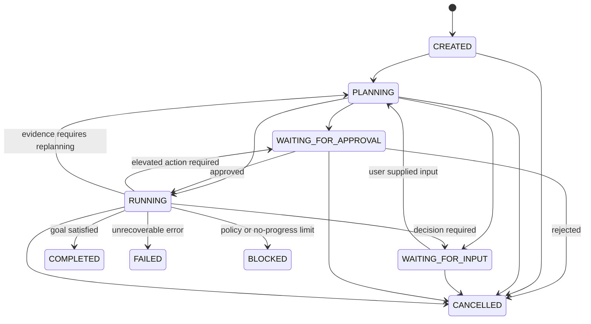
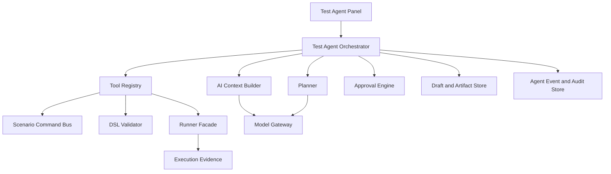

# Test Agent 产品与架构设计

## 1. 文档目的

本文定义平台中 Test Agent 的长期产品定位、任务模型、交互形态和分阶段路线。

更高层的产品目标、核心体验和成功标准见 [Test Agent 产品愿景](C:/Users/blaine/Documents/code/automation-test-poc1/design/test-agent-vision.md)。

它回答以下问题：

- Test Agent 与普通 Chatbot 有什么区别
- Agent Task 与 Scenario Execution、Suite Execution 有什么区别
- 统一对话入口如何与 Scenario、Suite 和 Execution 页面协作
- 当前受限 Agent 如何演进为受控 Sandbox Agent

工具、语义 Command、权限审批、执行循环和停止规则见 [Test Agent 工具与执行治理](C:/Users/blaine/Documents/code/automation-test-poc1/design/test-agent-runtime-governance.md)。

Agent Runtime 技术选型及 Spring AI、OpenCode、Skill 和 MCP 的边界见 [Test Agent Runtime 技术选型决策](C:/Users/blaine/Documents/code/automation-test-poc1/design/test-agent-runtime-technology-decision.md)。

本文描述目标架构，不表示所有能力都会在 V1 开放。

当前状态：`Design Baseline`

相关约束：

- [Test Agent 能力边界](C:/Users/blaine/Documents/code/automation-test-poc1/design/ai-assistance-boundaries.md)
- [AI 上下文与安全规范](C:/Users/blaine/Documents/code/automation-test-poc1/design/ai-context-and-security.md)
- [AI 产品交付规范](C:/Users/blaine/Documents/code/automation-test-poc1/design/ai-product-delivery-guidelines.md)

## 2. 产品定义

平台的长期 AI 定位是：

> Test Agent 是运行在 Test Workspace 内的领域 Agent。它将自然语言测试目标转化为结构化测试资产，并在经过授权的非生产环境中使用执行证据持续验证和改进这些资产。

Test Agent 不是通用聊天机器人，也不是平台管理员。

它主要操作以下领域对象：

- OpenAPI Spec 和 Operation
- Test Scenario 和 Scenario Step
- Test Suite
- Environment 和 Profile 的非敏感引用
- Scenario Draft 和 Suite Draft
- Validation Result
- Scenario Execution、Suite Execution 和脱敏 Evidence

Test Agent 的核心价值不是“回答问题”，而是帮助用户完成一个可检查、可恢复、可审计的测试任务。

## 3. Chat-first，Artifact-centered

平台提供统一的 Agent 对话入口，让用户通过自然语言表达目标，例如：

- 为创建订单接口补充异常场景
- 给当前 Step 增加一个 Header
- 从响应中提取订单号，并在下一步引用
- 检查这个 Scenario 的 Assertions 是否过弱
- 运行这个 Draft，并根据失败证据分析问题

但聊天记录不能成为测试资产的最终承载方式。

Agent 的结果必须落到平台原生对象中：

- Scenario Draft
- Suite Draft
- Command Plan
- Diff
- Validation Result
- Execution
- Failure Analysis

因此 UI 采用以下原则：

- Chat 是意图入口
- Plan 是过程说明
- Tool Activity 是行为证据
- Draft 和 Diff 是变更载体
- Scenario Editor 和 Suite Editor 是最终编辑界面
- Execution 页面是运行证据的最终查看界面

## 4. Test Agent 与普通助手的区别

普通助手通常完成单轮任务：

```text
用户提出问题
  -> AI 给出说明或建议
```

Test Agent 完成的是有状态、可迭代任务：

```text
用户定义测试目标
  -> Agent 收集项目上下文
  -> 生成计划
  -> 调用受控工具
  -> 创建或修改 Draft
  -> 执行确定性校验
  -> 在获得授权后运行
  -> 读取脱敏 Evidence
  -> 判断继续、请求用户决策或停止
```

Agent 可以跨越多个步骤推进目标，但每一步仍受权限、预算、校验器和用户审批约束。

V1 是受限 Test Agent，只完成读取、规划、Draft 修改、校验和 Diff。受控运行属于后续阶段。

## 5. Agent Task

### 5.1 定义

`AgentTask` 表示一个由用户目标驱动的 Agent 工作单元。

建议字段：

| 字段 | 说明 |
|---|---|
| `id` | Task ID |
| `projectId` | 所属 Project |
| `createdBy` | 发起用户 |
| `goal` | 用户原始目标 |
| `status` | 当前任务状态 |
| `permissionMode` | 本次任务的授权模式 |
| `environmentScope` | 允许使用的非生产 Environment 范围 |
| `targetRefs` | 相关 Scenario、Suite、Operation 或 Execution |
| `planRevision` | 当前计划版本 |
| `iterationCount` | 已完成迭代次数 |
| `budget` | 时间、Token、工具调用和执行次数限制 |
| `createdAt` | 创建时间 |
| `completedAt` | 完成或停止时间 |

### 5.2 Agent Task 不等于 Execution

二者必须分离：

| 对象 | 目的 | 特性 |
|---|---|---|
| Agent Task | 达成测试设计或诊断目标 | 可规划、调用多个工具、产生多个 Draft 或 Execution |
| Scenario Execution | 确定性运行一个 Scenario | 输入固定，产生不可变执行证据 |
| Suite Execution | 确定性运行一个 Suite | 包含有顺序的 Scenario Executions |

一个 Agent Task 可以不执行任何测试，也可以在授权范围内关联多个 Execution。

Execution 不能被 Agent 修改。Agent 只能读取经过脱敏的 Evidence，并基于新 Draft 发起新的 Execution。

### 5.3 生命周期



状态说明：

- `CREATED`：已记录用户目标，尚未开始规划
- `PLANNING`：收集上下文并生成或更新计划
- `WAITING_FOR_APPROVAL`：下一操作需要明确授权
- `RUNNING`：调用工具、修改 Draft、校验或观察 Evidence
- `WAITING_FOR_INPUT`：需要用户补充业务规则或做选择
- `COMPLETED`：目标已经达成，并且没有必需工作未完成
- `FAILED`：技术错误导致当前任务无法完成
- `BLOCKED`：安全策略、权限或连续无进展阻止继续
- `CANCELLED`：用户主动终止

`BLOCKED`、`FAILED` 和 `CANCELLED` 保留完整事件记录。用户继续工作时应创建 continuation task，并引用原 Task，而不是篡改原状态。

## 6. Agent Plan

Agent 在产生修改或执行行为前，应创建结构化 `AgentPlan`。

建议包含：

- 对用户目标的理解
- 目标资产
- 使用的事实来源
- 需要完成的步骤
- 每一步预计调用的工具
- 可能产生的 Draft 或 Execution
- 假设和风险
- 需要审批的步骤
- 完成条件

Plan 可以随着新证据修订，但每次修订必须：

- 增加 `planRevision`
- 说明修订原因
- 保留上一版本
- 重新评估审批是否仍然有效

小型操作可以使用单步 Plan，但不能绕过权限检查。

## 7. UI 形态

Test Agent 使用统一品牌和共享 Chat 组件，但按资源作用域采用不同承载方式：

- Scenario Agent 位于当前 Scenario 工作 Tab 的右侧 Sidecar
- Suite Agent 位于当前 Suite 工作 Tab 的右侧 Sidecar
- Project Agent 使用独立的 Project Agent 工作 Tab

对象级 Sidecar 让用户可以同时查看原生编辑器和 Agent 建议；Project Agent 独立 Tab 为跨资源 Context、Draft 和 Change Set 提供足够空间。

Chat 创建后 Scope 固定，History 按 Scope 隔离。模型和审批模式可以在非运行状态切换。Agent Task 在工作 Tab 切换后继续存在，但 UI 必须始终显示 Scope 和目标资产，防止修改错误资源。

页面内入口根据当前上下文自动确定 Scope，不要求用户在打开 Chat 前选择 Agent 类型。对象级请求超出当前 Scope 时，通过 `Continue in Project Agent` 创建新的 Project Chat，不静默扩大原 Task 权限。

完整的入口、布局、能力矩阵、状态管理、跨 Scope 交接和验收标准见 [Test Agent 作用域、能力与 UI 布局设计](C:/Users/blaine/Documents/code/automation-test-poc1/design/test-agent-ui-scope-and-layout.md)。

## 8. 总体架构



核心职责：

- `Test Agent Orchestrator`：维护 Task 状态、计划、预算和循环
- `AI Context Builder`：最小化、脱敏并标记事实来源
- `Planner`：生成结构化 Plan 和 CommandPlan
- `Tool Registry`：暴露平台白名单能力
- `Scenario Command Bus`：统一执行 UI 与 Agent 的语义命令
- `DSL Validator`：执行确定性合法性和依赖校验
- `Runner Facade`：实施 Environment Allowlist 和执行预算
- `Approval Engine`：根据副作用、Environment 和风险决定是否审批
- `Draft and Artifact Store`：保存未提交 Draft、Diff 和分析结果
- `Agent Event and Audit Store`：记录状态变化、工具调用和用户决策

运行时治理细节见 [Test Agent 工具与执行治理](C:/Users/blaine/Documents/code/automation-test-poc1/design/test-agent-runtime-governance.md)。

## 9. 分阶段交付

### Phase A: Restricted Test Agent

- 统一 Agent Panel
- 上下文感知对话
- 读取 OpenAPI、Scenario、Suite 和脱敏 Evidence
- 生成 Scenario Draft 和 Suite Draft
- 使用语义 Command 修改 Draft
- 展示 Diff 和 Validation
- 不运行、不保存、不修改配置

### Phase B: Approved Sandbox Run

- 用户逐次批准运行
- 只允许标记为 Agent 可执行的非生产 Environment
- Agent 读取脱敏 Evidence
- 根据 Evidence 生成下一版 Draft
- 用户决定是否再次运行

### Phase C: Bounded Autonomous Sandbox

- Task 级预授权
- 明确的 Environment Allowlist
- 严格的迭代、次数、时间和成本预算
- 风险动作仍需单独批准
- 完整暂停、取消和审计能力

生产环境自动执行不在路线范围内。

## 10. 产品验收问题

实现任何 Agent 能力前必须能回答：

- 该能力帮助用户完成哪个测试目标
- 结果最终落在哪个原生 Artifact
- Agent Task 如何表示完成、失败或阻塞
- 使用哪些结构化上下文
- 哪些步骤需要用户批准
- 用户如何审阅 Draft、Diff 和 Evidence
- 用户如何取消并恢复上下文
- 审计记录能否还原 Agent 做过什么
- 模型不可用时，手工工作流是否仍然完整

工具和执行相关的验收问题见 [Test Agent 工具与执行治理](C:/Users/blaine/Documents/code/automation-test-poc1/design/test-agent-runtime-governance.md)。
