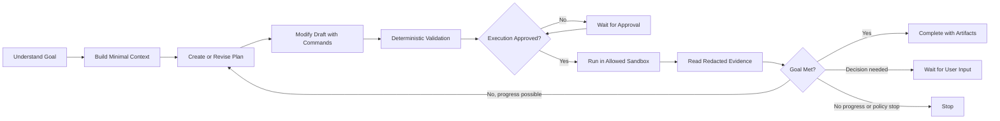
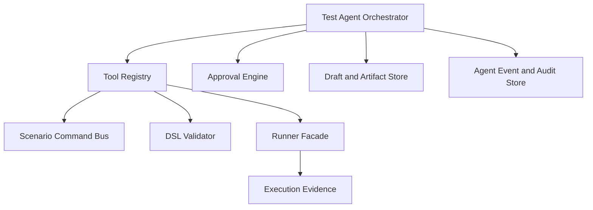

# Test Agent 工具与执行治理

## 1. 文档目的

本文定义 Test Agent 如何通过语义 Command 和白名单工具操作平台，以及权限、审批、受控执行和停止规则。

产品定位、Agent Task 和 UI 形态见 [Test Agent 产品与架构设计](C:/Users/blaine/Documents/code/automation-test-poc1/design/test-agent-architecture.md)。

本文描述目标架构。V1 只开放读取、Draft 修改和确定性校验，不开放 Agent 执行。

当前状态：`Design Baseline`

## 2. Scenario Command

### 2.1 语义命令优先

手工 UI 和 Test Agent 应共享同一套领域命令。

推荐命令：

- `SetScenarioName`
- `SetScenarioDescription`
- `SetScenarioVariables`
- `AddStep`
- `RemoveStep`
- `MoveStep`
- `RenameStep`
- `SelectOperation`
- `SetRequestHeader`
- `RemoveRequestHeader`
- `SetQueryParameter`
- `SetPathParameter`
- `SetRequestBody`
- `SetRequestBodyValue`
- `AddBeforeAction`
- `AddAfterAction`
- `AddAssertion`
- `RemoveAssertion`
- `AddExtraction`
- `RemoveExtraction`

不推荐将以下操作作为 Agent 工具：

- 点击某个按钮
- 修改某个输入框
- 操作 DOM
- 对 YAML 文本做字符串替换
- 对任意 JSON 路径应用无语义 Patch

语义命令可以被权限检查、确定性校验、Diff、Undo 和审计共同理解。

### 2.2 Command Plan

Agent 对资产的修改应先输出 `CommandPlan`：

```json
{
  "targetType": "SCENARIO_DRAFT",
  "targetId": "scenario-draft-id",
  "baseRevision": 12,
  "commands": [
    {
      "type": "SetRequestHeader",
      "stepId": "create-order",
      "name": "X-Request-Id",
      "value": "{{requestId}}"
    },
    {
      "type": "AddExtraction",
      "stepId": "create-order",
      "name": "orderId",
      "from": "$.data.id"
    }
  ],
  "assumptions": [],
  "warnings": []
}
```

平台处理顺序：

```text
CommandPlan
  -> revision check
  -> command allowlist
  -> permission check
  -> apply to working copy
  -> schema validation
  -> semantic validation
  -> security policy check
  -> show Diff
  -> user applies
```

所有命令应作为一个事务处理。任一命令失败时，不得留下半完成修改。

`baseRevision` 不匹配时，平台必须要求 Agent 重新读取资产并生成新 Plan，不能覆盖用户的新修改。

## 3. Tool Registry

Agent 只能通过白名单 Tool Registry 操作平台。

每个工具必须声明：

- 工具名称和版本
- 输入和输出 Schema
- Tool Effect
- 所需用户权限
- 是否需要审批
- Environment 约束
- 超时和资源限制
- 脱敏和审计策略

### 3.1 工具副作用分级

| Effect | 说明 | 示例 |
|---|---|---|
| `READ` | 读取结构化、脱敏上下文 | `getScenario` |
| `DRAFT_WRITE` | 修改未保存 Draft | `applyScenarioCommands` |
| `VALIDATE` | 执行确定性静态校验 | `validateScenarioDraft` |
| `EXECUTE_SANDBOX` | 在允许的非生产环境运行 | `runScenarioDraft` |
| `PERSIST` | 保存或覆盖正式资产 | `saveScenario` |
| `CONFIGURE` | 修改 Environment、Profile、权限或 Key | `updateProfile` |
| `SECRET_ACCESS` | 读取 Secret 原始值 | 不应提供 |

### 3.2 建议工具

只读工具：

- `listProjectApiSpecs`
- `searchProjectApiOperations`
- `getApiOperationSchema`
- `readApiSpecFragment`
- `getScenario`
- `getSuite`
- `listScenarioSummaries`
- `getSupportedActions`
- `getRedactedExecutionEvidence`
- `calculateCoverage`

Draft 工具：

- `createScenarioDraft`
- `createSuiteDraft`
- `applyScenarioCommands`
- `applySuiteCommands`
- `validateScenarioDraft`
- `validateSuiteDraft`

受控执行工具：

- `runScenarioDraft`
- `runSuiteDraft`
- `getExecutionStatus`
- `cancelAgentExecution`

V1 只开放 `READ`、`DRAFT_WRITE` 和 `VALIDATE`。

`PERSIST`、`CONFIGURE` 和 `SECRET_ACCESS` 不应成为 Agent 工具。正式保存继续使用平台原生用户操作。

## 4. 授权模式

每个 Agent Task 必须选择一个明确的权限模式：

| 模式 | 能力 | 建议阶段 |
|---|---|---|
| `Suggest Only` | 读取、解释、生成建议和 Command Plan | V1 |
| `Edit Drafts` | 可在未保存 Draft 中应用命令并校验 | V1 |
| `Run In Sandbox` | 用户逐次批准后在允许环境运行 | 后续 |
| `Autonomous Sandbox` | 在预授权范围和预算内迭代运行 | 远期 |
| `Production` | 生产环境执行 | 禁止 |

授权必须同时受到以下范围限制：

- Project
- 目标资产
- Environment Allowlist
- Tool Effect
- 最大执行次数
- 最大迭代次数
- 过期时间

用户对一次工具调用的批准，不能自动扩大为整个 Task 的长期授权。

自然语言中的“直接帮我执行”是用户意图，不是系统权限。Agent 仍须经过 Approval Engine。

## 5. 风险与审批

Approval Engine 应综合判断：

- Tool Effect
- Environment 风险级别
- Operation 风险级别
- 用户权限
- Task 当前授权模式
- 剩余执行预算
- 是否涉及批量操作

以下操作即使在 `Autonomous Sandbox` 中也建议单独审批：

- `DELETE`、退款、取消、清理等潜在破坏性 Operation
- 首次使用某个 Environment
- 批量运行 Suite
- 超出原 Plan 的新增 Operation
- 改变 Expected Value 或关键 Assertion
- 提高执行次数、迭代次数或超时预算

平台不能只根据 HTTP Method 判断风险，应允许 Project 为 Operation 标注风险等级。

## 6. 受控执行循环

未来开放 Sandbox 执行后，Agent 使用以下循环：



Agent 不能直接持有 Profile Secret。Runner 负责在执行边界内解析 Secret，并只返回脱敏 Evidence。

每次运行必须创建普通的 Scenario Execution 或 Suite Execution。Agent Task 只保存引用，不能创建第二套执行证据。

## 7. 停止条件

Agent 必须在以下任一条件满足时停止自动推进：

- 目标已经达到，Draft 校验通过，所需结果已生成
- 达到最大迭代次数、执行次数、时间或成本预算
- 连续多次出现相同失败且没有产生新证据
- 需要业务规则、Expected Value 或风险选择
- 需要访问未授权 Environment、资产或工具
- 可能涉及生产环境
- 检测到破坏性 Operation，但没有对应批准
- Secret、权限或安全策略阻止继续
- Evidence 更像产品缺陷，继续修改测试会掩盖问题
- 用户取消任务

Agent 不得通过以下方式伪造进展：

- 删除失败 Assertion
- 把 Expected Value 改成 Actual Value
- 扩大通过条件
- 忽略签名、加密或解密失败
- 重复运行相同输入并期待偶然成功
- 隐藏失败 Evidence

停止时必须说明：

- 已完成的工作
- 当前 Draft 和 Validation 状态
- 关联的 Executions
- 阻止继续的原因
- 需要用户做出的决定

## 8. 运行时组件



组件职责：

- `Tool Registry`：管理白名单、Schema、Effect 和权限要求
- `Scenario Command Bus`：统一执行 UI 与 Agent 的语义命令
- `DSL Validator`：执行确定性合法性和依赖校验
- `Runner Facade`：实施 Environment Allowlist 和执行预算
- `Approval Engine`：根据 Effect、Environment 和风险决定是否审批
- `Draft and Artifact Store`：保存未提交 Draft、Diff 和分析结果
- `Agent Event and Audit Store`：记录状态变化、工具调用和用户决策

## 9. 治理验收问题

实现任何 Agent Tool 前必须能回答：

- Tool Effect 是什么
- 输入和输出使用什么 Schema
- 是否只能作用于 Draft
- 哪些判断由确定性代码完成
- 如何处理 `baseRevision` 冲突
- 是否需要审批，审批范围和有效期是什么
- 如何限制 Environment、执行次数和迭代次数
- 如何脱敏输入、输出和审计记录
- 用户如何取消正在进行的工具调用
- 哪些条件表示完成、失败或阻塞

如果这些问题没有明确答案，该工具不应进入 Tool Registry。
